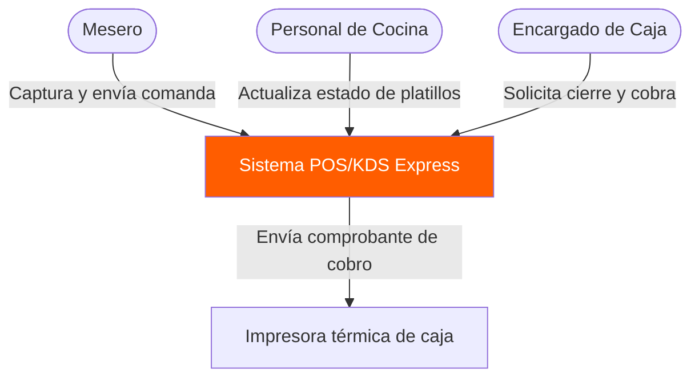
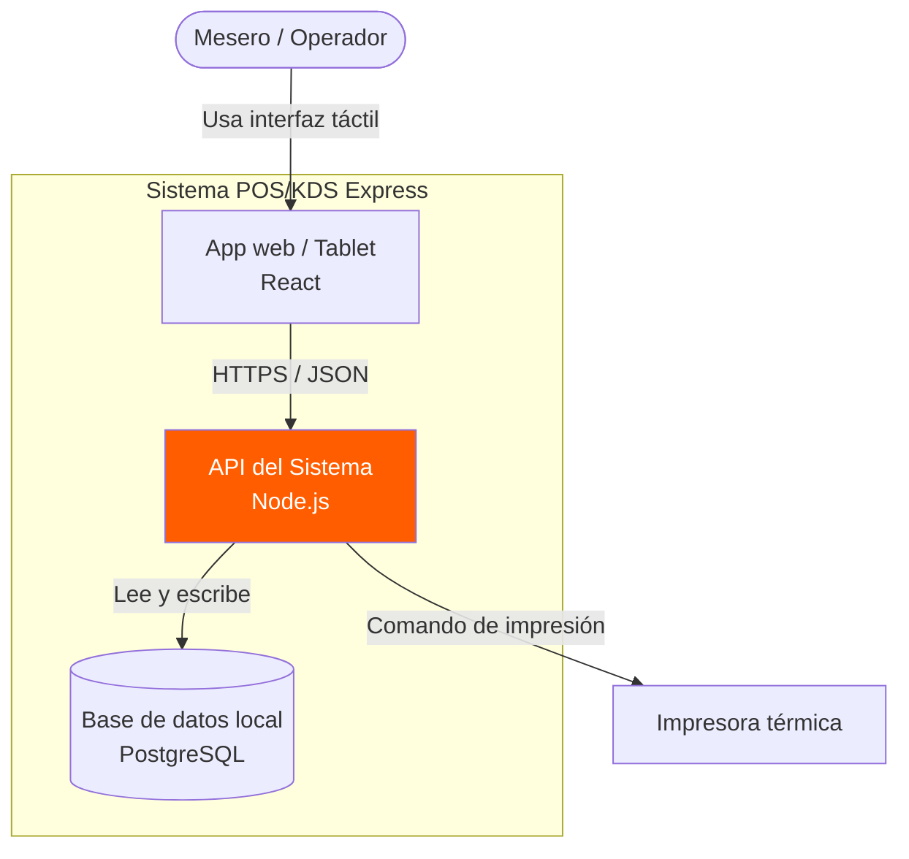
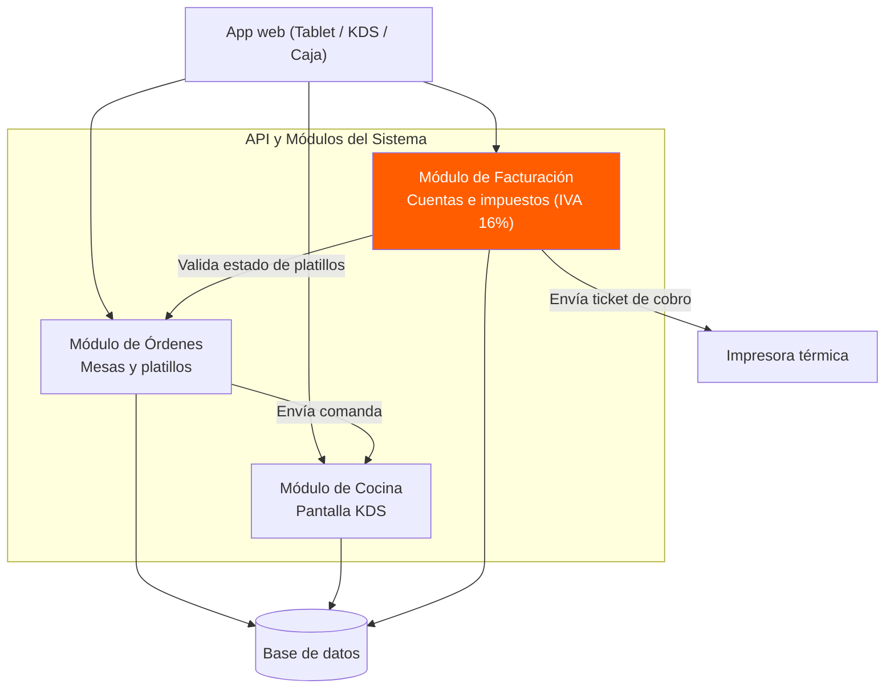
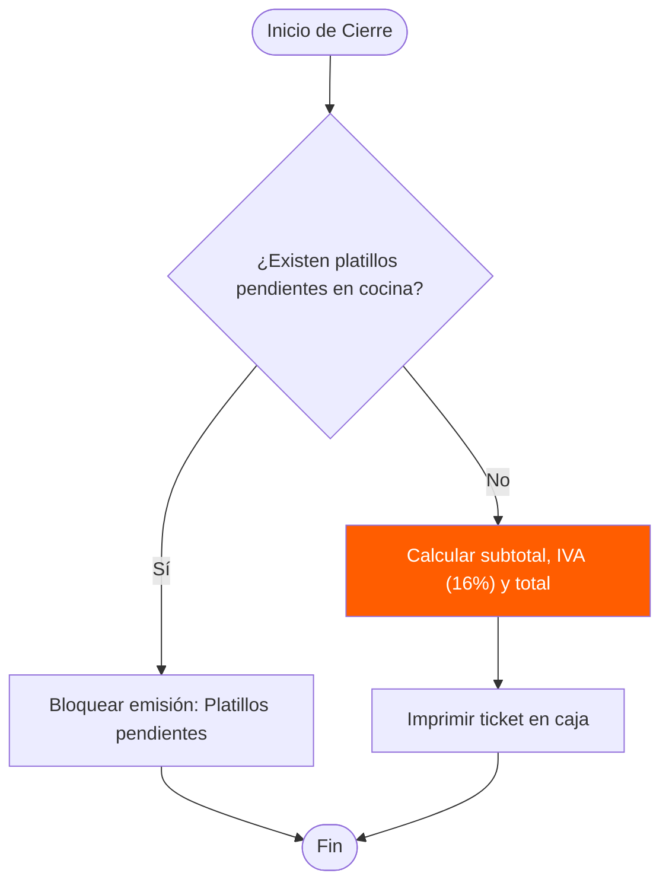
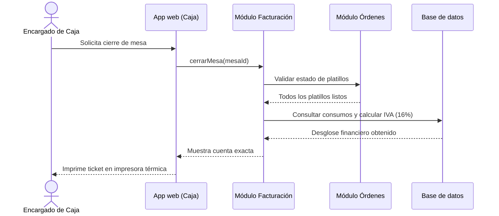
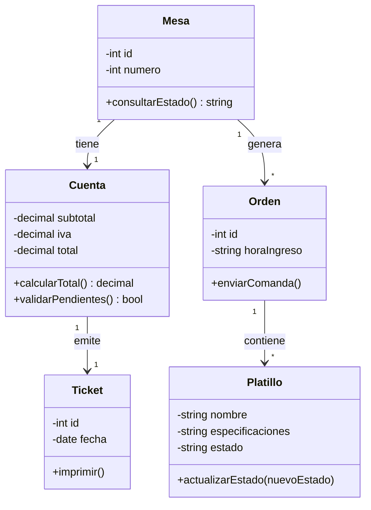
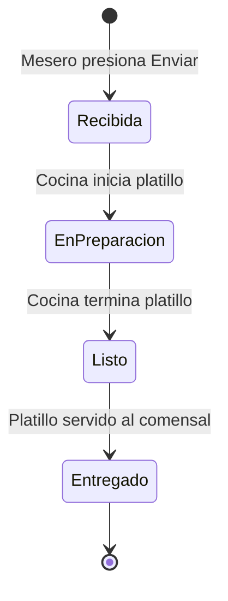
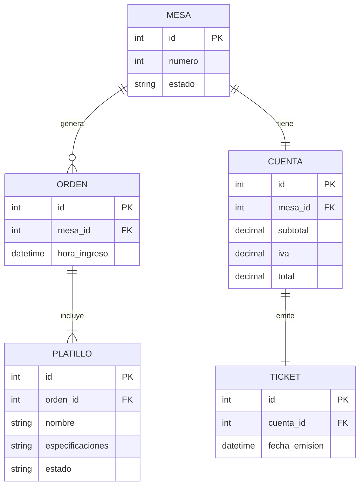

# Diagramas de Mermaid de Express Restaurante.

Este documento tiene los 8 diagramas de Mermaid pero con la información del sistema de Express Restaurante.

---

## Diagrama 1. Diagrama de contexto

---

## Diagrama 2. Diagrama de contenedores

---

## Diagrama 3. Diagrama de componentes

---

## Diagrama 4. Diagrama de flujo

---

## Diagrama 5. Diagrama de secuencia

---

## Diagrama 6. Diagrama de clases

---

## Diagrama 7. Diagrama de estados

---

## Diagrama 8. Diagrama entidad-relación

---

