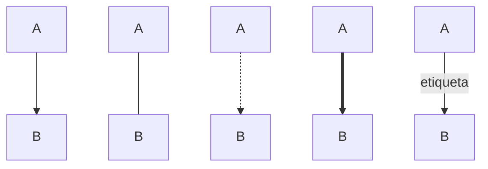
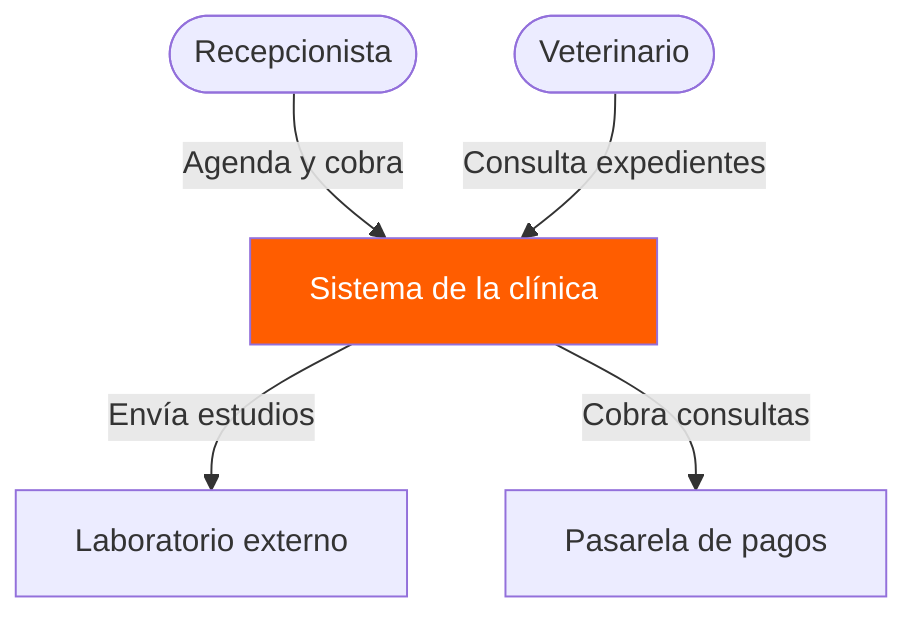
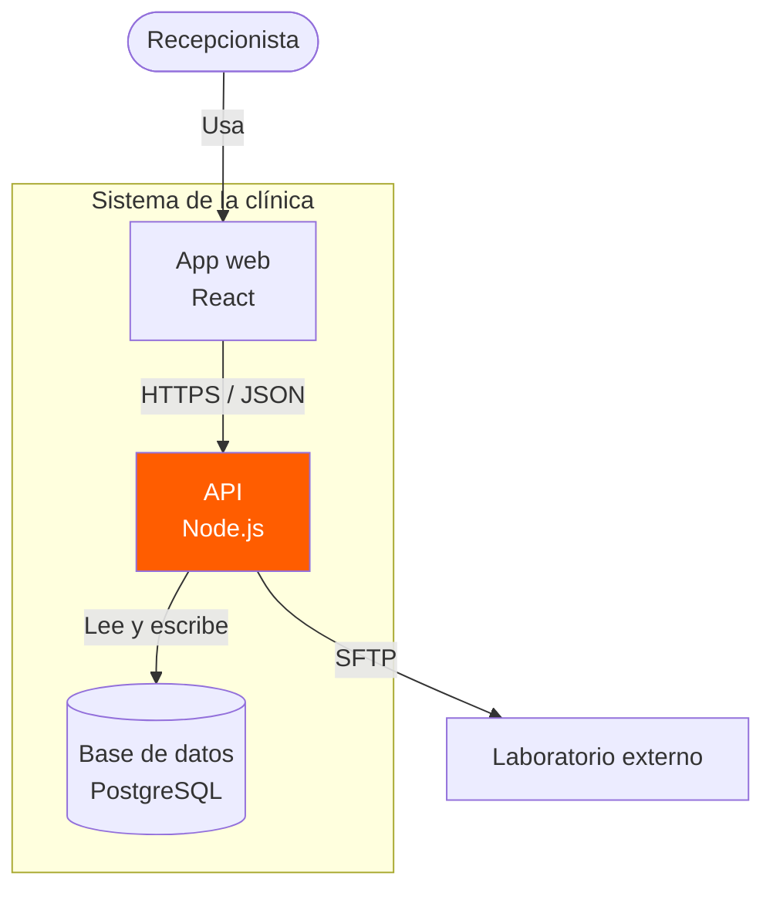
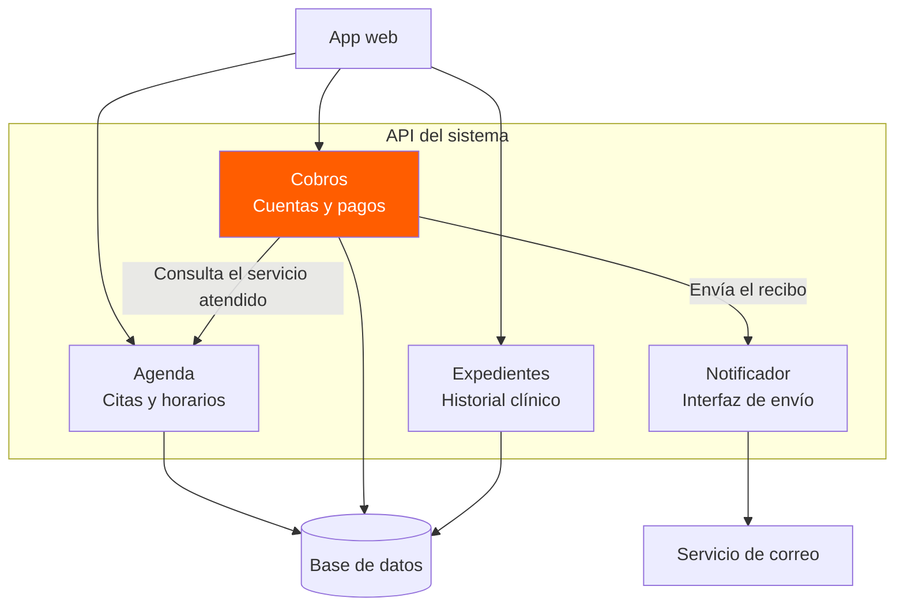
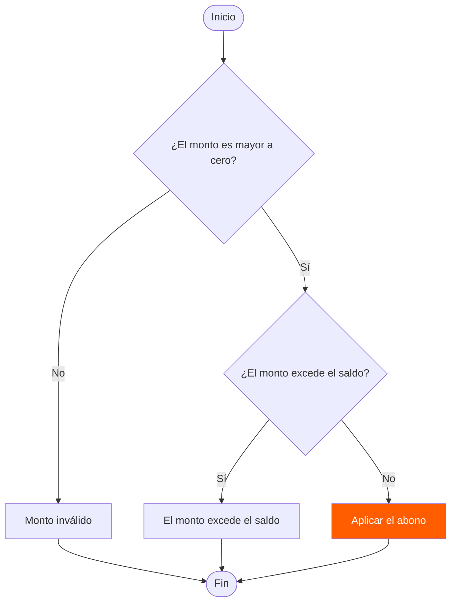
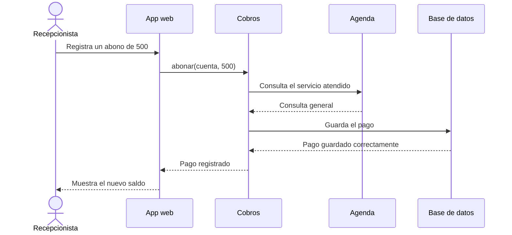
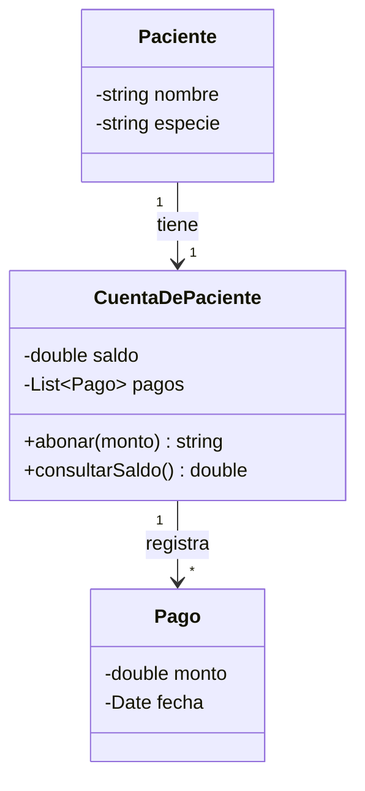
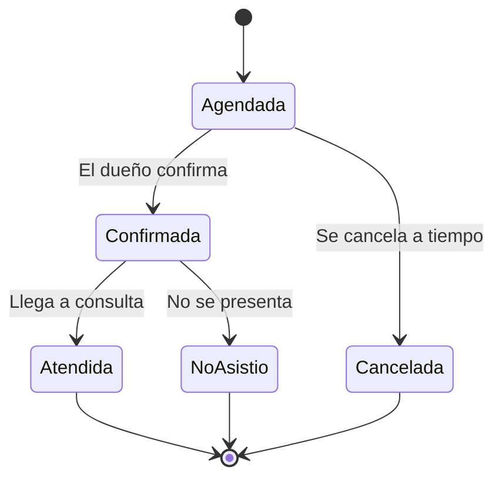
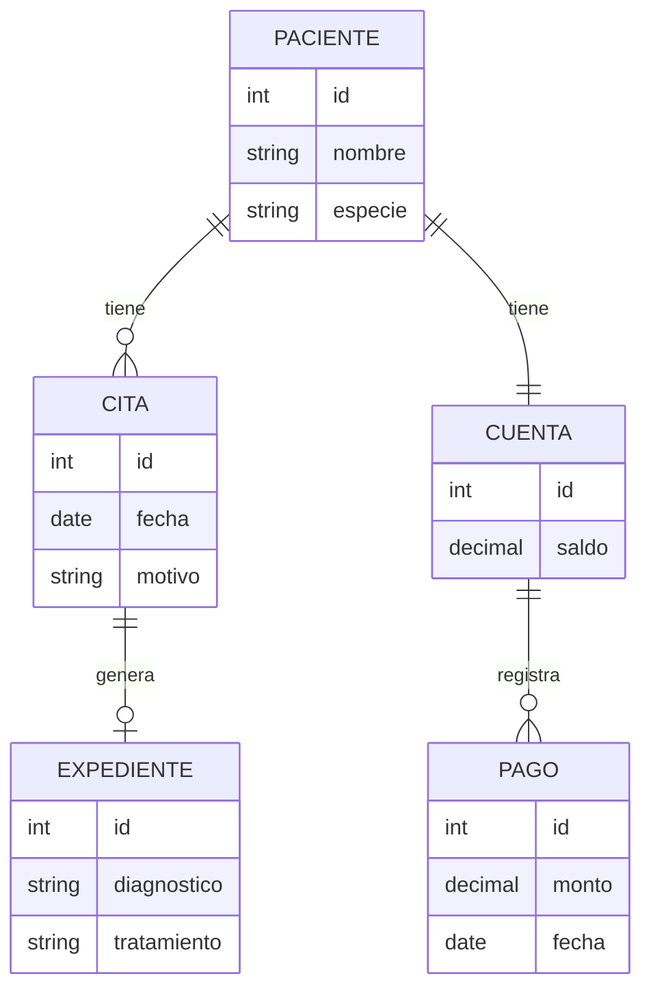

# Diagramas de Mermaid

Este documento contiene ocho diagramas elaborados con Mermaid para representar el funcionamiento, la estructura y los procesos de un sistema de gestión de una clínica veterinaria.

---

## Ejemplo: Tipos de flecha

---

## Diagrama 1. Diagrama de contexto

Representa las interacciones entre los usuarios, el sistema de la clínica y los servicios externos.

---

## Diagrama 2. Diagrama de contenedores

Muestra los principales componentes tecnológicos del sistema y la comunicación entre ellos.

---

## Diagrama 3. Diagrama de componentes

Representa los componentes funcionales de la API y sus relaciones con la aplicación web, la base de datos y el servicio de correo.

---

## Diagrama 4. Diagrama de flujo

Describe el proceso para validar y aplicar un abono a una cuenta de paciente.

---

## Diagrama 5. Diagrama de secuencia

Muestra la comunicación entre la recepcionista, la aplicación web, los componentes de cobros y agenda, y la base de datos durante el registro de un abono.

---

## Diagrama 6. Diagrama de clases

Representa las clases principales relacionadas con los pacientes, sus cuentas y los pagos registrados.

---

## Diagrama 7. Diagrama de estados

Describe los posibles estados de una cita veterinaria desde que se agenda hasta que finaliza o se cancela.

---

## Diagrama 8. Diagrama entidad-relación

Representa las relaciones entre los pacientes, las citas, los expedientes clínicos, las cuentas y los pagos.

---

**Fin del documento.**
